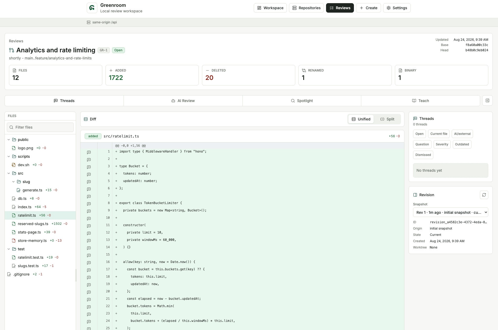
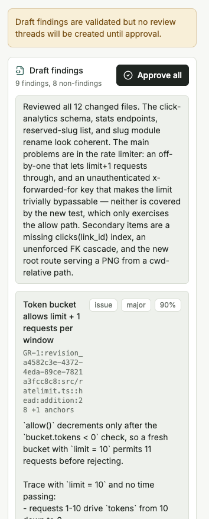
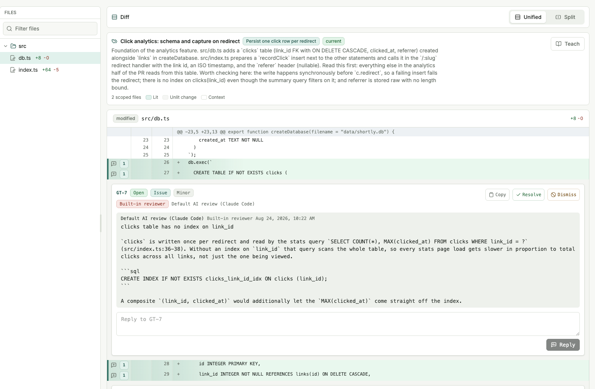
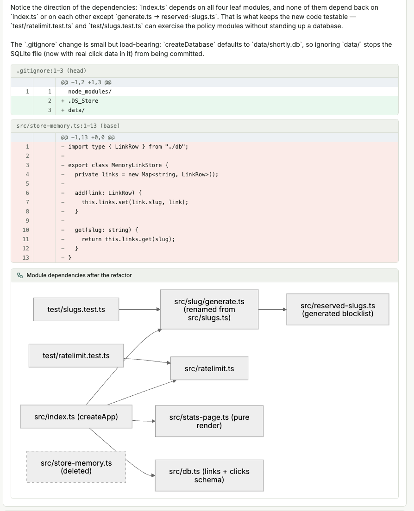

# Greenroom

Greenroom is a local-first review PR system for AI-assisted code changes. You
register local Git worktrees, create reviews from committed ranges or the
current working tree, triage durable inline threads in a browser workspace,
and let coding-agent harnesses (Claude Code, Codex, Pi) review, explain, and
teach the diff through consent-gated, MCP-first workflows. Everything runs on
your machine: the data is SQLite in your app data directory, and the AI
backend is the harness CLI you already have installed and authenticated.

The browser is the only UI surface. The `greenroom` CLI (or Docker) starts and
supervises every service and prints one URL to open.



New here? The [Quickstart guide](docs/Quickstart.md) walks through every
feature with screenshots, from first launch to a fully triaged review.

## Why Greenroom

I built Greenroom because raw `git diff` output and editor diff views get
hard to parse for larger changes — especially changes authored by AI coding
agents. I wanted a local tool with a richer review UI for the personal
review pass that happens (or should happen) before code gets pushed —
before the burden of review lands on teammates, or the feedback loop gets
bogged down in CI cycles. In the age of AI coding tools, humans still own
and are responsible for the codebases they maintain, and owning a change
means being able to review, validate, and understand it first.

Two design decisions follow from that:

- **The AI features run through your existing coding harness** rather than
  direct provider API calls. Harness subscriptions are usually cheaper than
  per-token API usage, and if you have already tuned your harness — skills,
  MCP servers, system prompts, permissions — Greenroom rides that setup
  instead of asking you to configure and pay for a second agent. (For
  API-key users, the managed Pi harness fills the same role.)
- **Everything stays local.** Reviews, threads, and redacted AI run
  transcripts live in a SQLite database on your machine, and reviewed
  repositories are read-only inputs that Greenroom never mutates.

The same tooling works in reverse — for understanding code you didn't
write. Pull a branch or a whole repository into a review and use the diff
workspace, AI review, Spotlight, and Teach to work out what it does, then
use your harness to validate your read of it.

## A tour of the features

**Reviews and structured diffs.** Create a review from the current worktree
(uncommitted changes included), any pair of committed refs, or a whole
repository at a ref — with a full diff preview before anything is stored.
The workspace renders structured Git detail (renames with similarity,
binary markers, mode changes), offers unified and split layouts, handles
very large files by truncating with load-more controls, and is
keyboard-navigable throughout. Refreshing a review snapshots a new revision
and remaps existing threads onto the new diff, flagging low-confidence
matches as outdated instead of guessing.

**Review threads.** Durable comments anchored to one or more changed lines,
typed (question / issue / suggestion / note) with optional severity, and
attributed to their source — human, built-in reviewer, or a connected
agent. Every thread gets a stable global ref like `GT-5` that means the
same thing in the UI, the API, and MCP tools, which makes handing findings
to a coding agent a one-liner.

**Built-in AI review.** Your harness reviews the diff through Greenroom's
MCP tools and submits schema-validated findings. Runs are consent-gated —
you see the exact scope before anything is shared — and findings land as a
draft for your approval before any threads are created.



**Spotlight.** The harness proposes a plan that splits a large review into
intent-coherent Views — one per feature, refactor, or architectural line —
which you can refine with your own instructions before approving. Each View
is a focused sub-diff of the review, and a coverage indicator shows any
changed lines no View explains.



**Teach.** An interactive explanation of the change: summary, architecture,
a point-by-point walkthrough with inline diff excerpts and diagrams, a quiz
that scores your understanding, and scoped follow-up Q&A. Anything you miss
can be promoted into a real review thread.



**MCP for external agents.** The same review data powers a local MCP server
with scoped bearer tokens. Any MCP-capable agent can list reviews, read
diffs and threads, comment with attribution, and pull handoff bundles — the
Settings → Connections page mints tokens and emits ready-to-paste client
configs.

## Requirements

- Bun 1.3.14 or newer (`bun --version`)
- Git on your PATH
- Optional, for AI workflows: a coding-agent harness CLI on the host —
  Claude Code (`claude`), or the managed Pi fallback for API-key users (see
  [AI backends](#ai-backends-harnesses) below). Without one, review and
  triage still work and mock AI profiles are seeded for demos.

## Quick Start (CLI)

```sh
bun install
bun run greenroom -- up
```

`greenroom up` supervises the whole stack in the foreground — local HTTP API,
harness bridge, HTTP MCP server — builds the web app once if needed, serves it
statically from the API process, and prints the one URL to open. Ctrl-C stops
everything. There is no manual token or bridge wiring: `up` bootstraps an
admin API token and auto-provisions a persisted bridge token, so the API and
bridge match out of the box.

On first open, the browser routes to the setup wizard at `/setup`, which walks
through: browser token → repository registration → harness detection and
smoke check → seeded AI profiles → first review. Every step is skippable and
the wizard can be re-run from Settings.

Other commands (see [docs/CLI.md](docs/CLI.md)):

```sh
bun run greenroom -- status              # per-service state, ports, URLs
bun run greenroom -- down                # stop a running `up` from another terminal
bun run greenroom -- token create        # mint a scoped API token
bun run greenroom -- harness install-pi  # managed Pi fallback install
bun run greenroom -- config              # resolved config + value sources
bun run greenroom -- db backup           # consistent SQLite snapshot
```

Pass `--dev` to `up` to run the Vite dev server with HMR instead of the
static build.

## Quick Start (Docker)

Docker is the co-primary deployment path: one container runs the API, the
static web app, and the HTTP MCP endpoint, published on loopback only by
default.

```sh
docker compose up --build        # or: bun run compose:up
```

Open `http://localhost:49331`; the same first-run wizard applies. Harness CLIs
stay on the host next to your existing installs and auth — the container
reaches them through a host-side bridge. Building from a clone is the
currently available path; a published image is planned for a future GitHub
Release. See [docs/Docker.md](docs/Docker.md) for the read-only code root
mount, host-side harness bridge setup, data/config volumes, and LAN exposure
caveats. The development compose
file (`compose.dev.yaml`: Vite dev server plus split api/frontend/mcp
services) remains available as `bun run compose:dev:up`.

## AI Backends (Harnesses)

Greenroom's AI backend is harness-based: the API calls a
supervised host-side bridge, and the bridge spawns your installed coding-agent
CLI with your existing subscription and auth. Direct provider adapters (for
example, an OpenAI Responses adapter) are not supported.

- **Claude Code** — detected automatically (`claude` on PATH) and fully
  supported for Teaching, Spotlight, and built-in AI review.
- **Pi** — the API-key fallback for users without a harness subscription.
  `greenroom harness install-pi` installs a pinned, Greenroom-managed copy
  under the app data dir; export a provider API key (for example
  `ANTHROPIC_API_KEY`) before `greenroom up`.
- **Codex** — detected automatically and supported for Teaching, Spotlight,
  and built-in AI review through an isolated, ephemeral, read-only CLI run.
- **Mock** — when no harness CLI is detected, mock profiles are seeded so the
  UI flows can be exercised without any AI backend.

On a fresh database, default AI profiles are seeded from what harness
detection actually finds. AI runs are consent-gated (one-click by default,
with per-profile trusted and two-step modes), redacted transcripts are
persisted per run with retention caps, and reviewed repositories are never
mutated. See [docs/Harness.md](docs/Harness.md).

## Architecture

The browser is Greenroom's only UI surface. It runs against services started
by the CLI or Docker:

- **API server** (`apps/server`) — Hono HTTP API over SQLite (`bun:sqlite` +
  Drizzle): repositories, reviews, revisions, structured diffs, threads,
  profiles, workflow runs, scoped capability tokens, OpenAPI output. Binds
  loopback by default; non-loopback binds disable unauthenticated setup-token
  minting and require a pre-provisioned token.
- **Web app** (`apps/web`) — Vite, React, TanStack Router/Query, Tailwind.
  Served statically by the API process in normal operation; the Vite dev
  server is a `--dev` opt-in.
- **MCP server** (`packages/mcp`) — dependency-free MCP adapter (stdio and
  HTTP JSON-RPC) exposing `greenroom_*` tools and `greenroom://` resources for
  external coding agents.
- **Harness bridge** (`packages/harness`) — host-side HTTP bridge that detects
  installed harness CLIs, spawns them for approved workflow runs, and returns
  schema-bound JSON.
- **Supervisor/CLI** (`packages/supervisor`, `packages/cli`) — the `greenroom`
  command that provisions tokens, picks ports, starts/stops/monitors all of
  the above, and exposes runtime status to the Settings page.

Non-secret runtime configuration lives in a `greenroom.toml` file in the app
data dir (ports, bridge, path maps, workflow limits), with per-key precedence
env var > config file > built-in default; env vars are reserved for secrets
and overrides. The Settings page edits the editable subset. See
[docs/Environment.md](docs/Environment.md).

## Package Layout

- `apps/server` - local Hono API and storage workspace: SQLite path
  resolution, Drizzle tables and hand-written migrations, persistence
  services, review creation and revision refresh, workflow orchestration,
  config-file loading, and the `server:dev` CLI.
- `apps/web` - browser workspace for the dashboard, review creation, the
  diff/thread workspace, the Teach page, the setup wizard, and Settings.
- `packages/cli` - the `greenroom` command (`up`, `down`, `status`,
  `token create`, `harness install-pi`, `config`, `db backup`).
- `packages/supervisor` - service supervision, port selection, token
  bootstrap, and runtime state shared by the CLI.
- `packages/harness` - the host harness bridge: CLI detection and version
  tracking, per-kind command presets (Claude Code, Pi, raw command), and the
  bridge HTTP server.
- `packages/mcp` - dependency-free MCP adapter with a local HTTP client,
  Greenroom tool/resource handlers, stdio and HTTP JSON-RPC entrypoints, and
  the `docs:mcp` generator.
- `packages/schemas` - shared Zod schemas and inferred TypeScript types.
- `packages/core` - storage-independent domain factories and validators.
- `packages/git` - Git CLI wrappers, review range construction, committed-ref
  and worktree diff generation, structured patch parsing, and temp-repo test
  fixtures.
- `tests/` - root-level test infrastructure and cross-workspace tests.
- `types/` - shared ambient TypeScript declarations.

The root `package.json` declares the Bun workspaces as `apps/*` and
`packages/*`.

## Developing Individual Services

For end-to-end behavior, prefer `bun run greenroom -- up` (or `up --dev` for
HMR). When working on only the API or web app, the services can still be run
manually:

```sh
bun run server:dev -- --host 127.0.0.1 --port 49331   # API only
bun run web:dev                                        # Vite dev server
```

During Vite development the browser calls same-origin `/api` routes and Vite
proxies them to `http://127.0.0.1:49331` (override with
`GREENROOM_API_PROXY_TARGET`). With a bare `server:dev` there is no
supervisor-bootstrapped token; create the first local setup token from the
Settings page. Manual harness bridge startup for standalone setups is covered
in `docs/Harness.md` → "Advanced Bridge Mode".

## Verification Commands

Run the full local verification suite:

```sh
bun run verify
```

Useful focused commands:

```sh
bun run format:check
bun run lint
bun run typecheck
bun run test:unit
bun run test:unit:coverage
bun run test:ui
bun run test:ui:live
bun run web:build
bun run docs:mcp
```

Notes:

- If your shell cannot find `bun` but Bun is installed in the default location,
  run commands with `${BUN_INSTALL:-$HOME/.bun}/bin/bun`.
- `bun run format` and `bun run lint:fix` apply formatting or lint fixes.
- `bun run test:ui` starts the Vite web app through Playwright and runs the
  browser smoke tests for the app shell, primary navigation, thread triage,
  workspace shortcuts, and large-diff controls.
- `bun run test:ui:live` builds the web app and runs the live-API Playwright
  suite (`tests/live/`, `playwright.live.config.ts`): a real API server,
  harness bridge, and mock coding-agent CLI over a temporary git repository,
  with no mocked API routes. CI runs it via `.github/workflows/ci.yml`.
- `bun run verify:coverage` runs the full verification suite and then unit
  tests with coverage.
- `bun run docs:mcp` regenerates the generated tables in `docs/MCP.md` from
  the MCP tool/resource definitions; a unit test fails when they drift.

## TypeScript Configs

- `tsconfig.base.json` - strict shared compiler options.
- `tsconfig.json` - root project reference entry point used by
  `bun run typecheck`.
- `tsconfig.bun.json` - base config for Bun/server-side packages.
- `tsconfig.browser.json` - base config for browser packages with DOM and React
  JSX support.

New workspaces should extend the closest matching environment config and be
added to the root TypeScript project references when they need to participate
in `bun run typecheck`. Referenced package workspaces emit TypeScript
declarations under their local `dist/` directories during `bun run typecheck`;
generated `dist/` output remains ignored by Git.

## Documentation

The [documentation landing page](docs/README.md) indexes every guide. Direct
links:

- [docs/Quickstart.md](docs/Quickstart.md) - a guided, screenshot-heavy tour
  from first launch through every feature.
- [docs/CLI.md](docs/CLI.md) - `greenroom` commands, the first-run wizard,
  web serving modes, bridge supervision, and runtime state.
- [docs/Docker.md](docs/Docker.md) - single-container deployment, volumes,
  host-side bridge, LAN exposure.
- [docs/Environment.md](docs/Environment.md) - the `greenroom.toml` config
  file reference, secrets, and environment overrides.
- [docs/Harness.md](docs/Harness.md) - harness detection, Pi managed install,
  profiles, workflows, timeouts, privacy.
- [docs/MCP.md](docs/MCP.md) - connecting external coding agents, token
  scopes, generated tool/resource tables.
- [docs/Teaching.md](docs/Teaching.md) - the Teach page, consent flow, quiz
  and follow-up sessions, thread promotion, persistence.
- [docs/API.md](docs/API.md) - local API startup and endpoint details.
- [docs/Git.md](docs/Git.md) - Git assumptions, supported diff cases, limits.
- [docs/Threads.md](docs/Threads.md) - thread states, triage filters, short
  refs, severity, source attribution.

## Development Notes

- Keep generated output out of source control. Current ignores cover
  `node_modules/`, `dist/`, `coverage/`, and TypeScript build info files.
- Reviewed repositories are read-only inputs: Greenroom never commits, tags,
  pushes, or writes state into them (see `docs/Environment.md`).
- Keep test and development databases under temporary directories; the test
  helpers in `apps/server/src/testing/storage.ts` create isolated SQLite
  databases and clean them up.
- Add tests near the code they cover. The root Vitest config discovers tests
  under `apps/`, `packages/`, and `tests/`.
- Public workflow, API, CLI, or configuration changes should update this
  README or the nearest relevant docs file in the same change.
