# Quickstart

This guide walks you from `bun install` to a fully reviewed change: creating
a review, reading the diff, leaving comments, and running Greenroom's three
AI workflows — built-in review, Spotlight, and Teach — through your own
coding harness. Screenshots come from reviewing a small example project (a
URL shortener called `shortly`), but everything works the same on your own
repositories.

If you just want the commands, the [README](../README.md) has them. This
guide is the scenic route.

## What you'll need

- **Bun 1.3.14 or newer** and **Git** on your PATH.
- Optionally, a coding-agent CLI for the AI features: Claude Code (`claude`)
  or Codex (`codex`) installed and authenticated, or the managed
  [Pi fallback](Harness.md#pi-fallback-managed-install) if you use API keys
  instead of a subscription. Without any harness, review and triage still
  work — the AI features are seeded with mock profiles so you can see the
  flows.

## Start Greenroom

One command starts everything — the API, the web app, the harness bridge,
and the MCP endpoint:

```
❯ bun run greenroom -- up
Starting Greenroom services (data dir /Users/you/Library/Application Support/Greenroom)...
  bridge: running
  api: running
  mcp: running

Greenroom is running: http://127.0.0.1:49331

  Web UI:   http://127.0.0.1:49331 (static, served by the API)
  API:      http://127.0.0.1:49331
  MCP:      http://127.0.0.1:49332/mcp
  Bridge:   http://127.0.0.1:49343 (harness bridge, supervised)
  Data dir: /Users/you/Library/Application Support/Greenroom

Press Ctrl-C to stop.
```

There's no token wiring or bridge configuration to do by hand — `up`
bootstraps all of it. From another terminal, `bun run greenroom -- status`
shows per-service health:

```
❯ bun run greenroom -- status
SERVICE  STATE    PORT   PID    URL
bridge   running  49343  97410  http://127.0.0.1:49343
api      running  49331  97414  http://127.0.0.1:49331
mcp      running  49332  97416  http://127.0.0.1:49332/mcp
web      running  -      -      http://127.0.0.1:49331
```

The full command set (`down`, `token create`, `config`, `db backup`, …) is
covered in [CLI.md](CLI.md). Prefer containers? The whole stack also runs as
a single Docker container — see [Docker.md](Docker.md).

## First-run setup

Open the printed URL. The first time a browser connects with no stored
token, Greenroom routes you to a five-step setup wizard: **Token**,
**Repository**, **Harness**, **Profiles**, and **First review**. Every step
is skippable, and you can re-run the wizard any time from Settings.

**Token.** The browser needs its own API token; one click mints it locally
and stores it in the browser. (Greenroom's API only allows this from the
machine it runs on.)

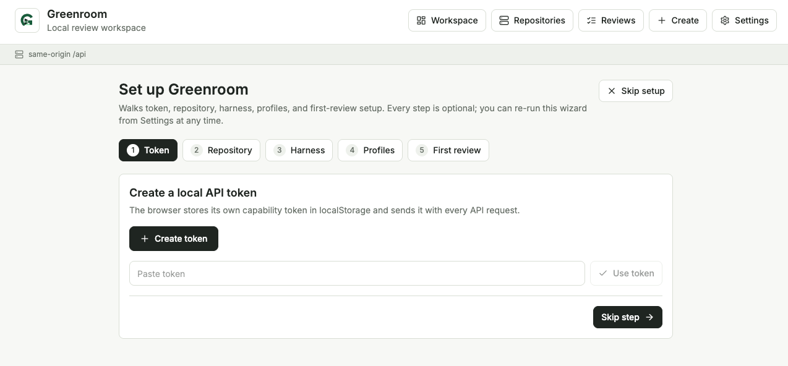

**Repository.** Point Greenroom at any local Git worktree by its absolute
path. Repositories are read-only inputs — Greenroom never commits, tags,
pushes, or writes any state into them.

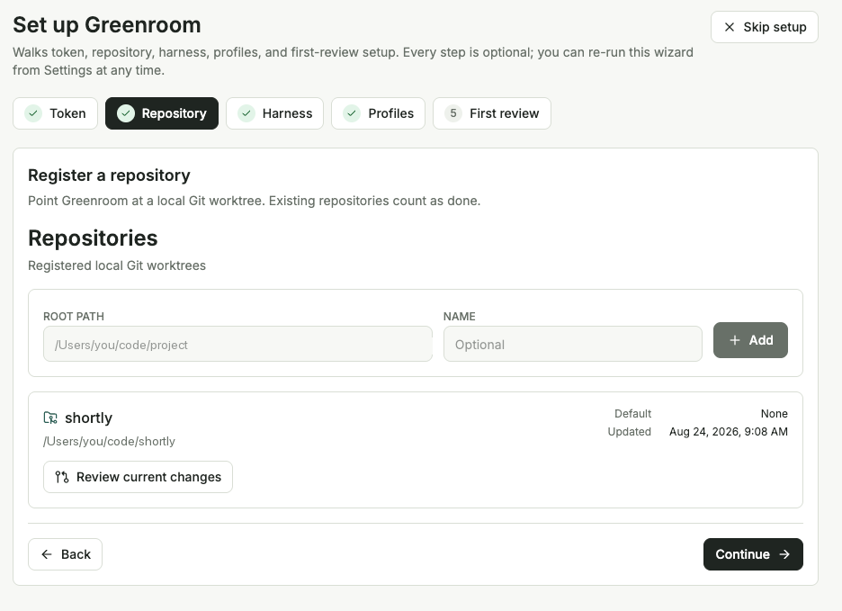

**Harness.** Greenroom detects the coding-agent CLIs installed on your
machine and offers a non-blocking smoke check to confirm it can actually
drive one end to end. If nothing is detected, this step shows the
`greenroom harness install-pi` fallback for API-key users.

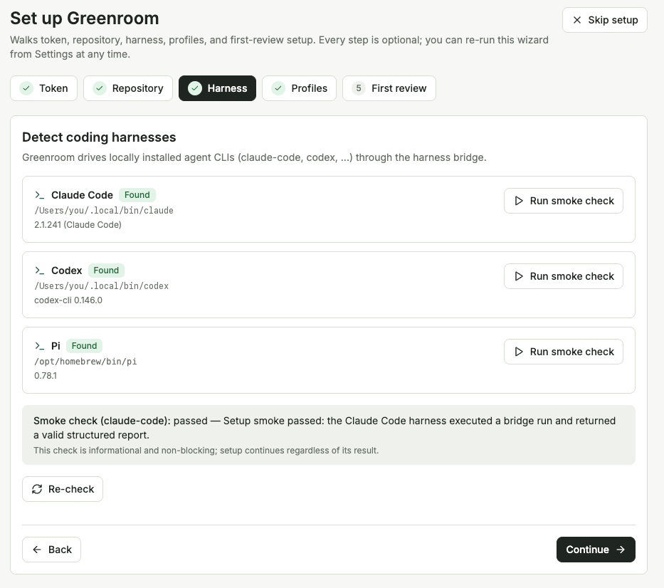

**Profiles.** Each AI feature runs under a *profile* — a stored
configuration naming the workflow (teaching, Spotlight, or built-in
review), the harness and model to use, an optional custom system prompt,
and privacy settings like consent mode and transcript persistence. Defaults
are seeded from whatever harness was detected; you can edit or add profiles
later in Settings.

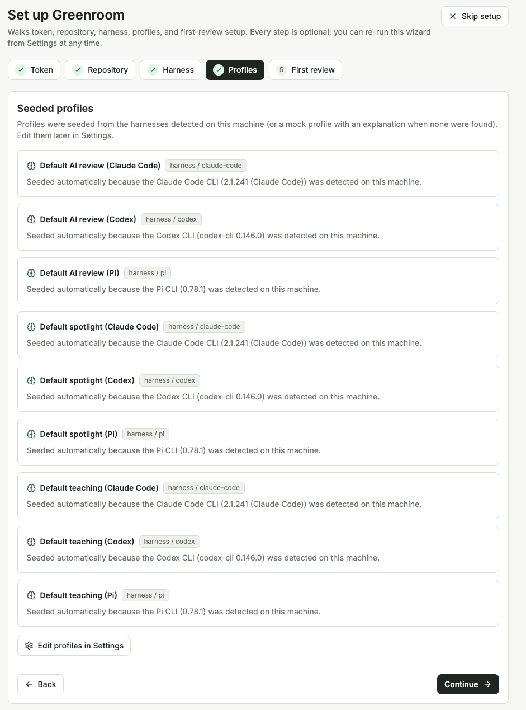

**First review** hands you off to the review creation page — but let's look
at the home page first.

## The Workspace

The **Workspace** page (the first item in the navigation) is Greenroom's
home: registered repositories on the left, reviews on the right. Reviews
are either **Open** or **Closed** — closing is how finished reviews get out
of the way, and it's reversible.

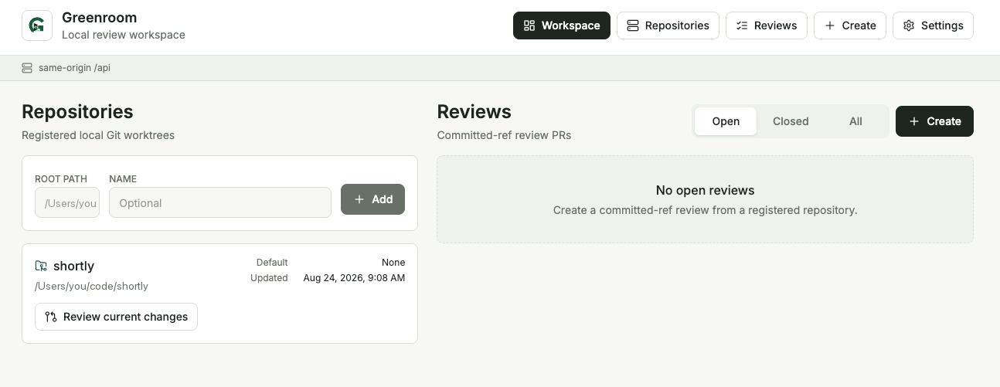

Each repository card also has a **"Review current changes"** button — a
one-click review of that repo's working tree. We'll use the full creation
flow instead, so you can see what it does.

## Creating a review

Click **"Create"** in the navigation. A review needs a repository and a
choice of mode:

- **Default** reviews the current worktree: everything committed since the
  detected base branch, plus staged and unstaged tracked changes. One
  honest limitation to know about: brand-new *untracked* files don't appear
  until you `git add` them — Greenroom won't touch your index to discover
  them, and the UI reminds you of this.
- **Custom** compares any two committed refs — branches, tags, or SHAs. A
  "Base candidates" card lists likely base refs (your branch's upstream,
  `origin/HEAD`, local `main`…) so you usually just click one instead of
  typing.
- **Whole repo** reviews every tracked file at a chosen ref as one big
  "everything added" diff — useful for getting oriented in a codebase you
  didn't write.

Click **"Preview"** and Greenroom shows exactly what the review will
contain — resolved SHAs, file counts, and the full diff — before anything
is stored. If the preview looks right, click **"Create"**.

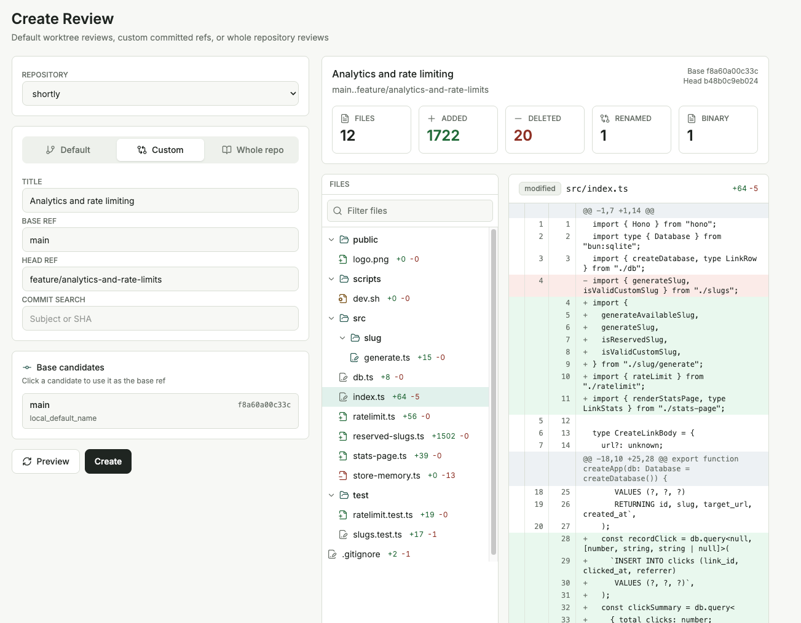

Every review gets a short display id like `GR-1` (Greenroom Review). These
ids are stable and shared across the UI, the API, and the MCP tools, which
makes them handy handles when talking to a coding agent: "summarize the
open threads in GR-1."

## Reading the diff

Creating a review drops you into the review workspace: changed files on the
left, the diff in the center, and a panel drawer on the right.

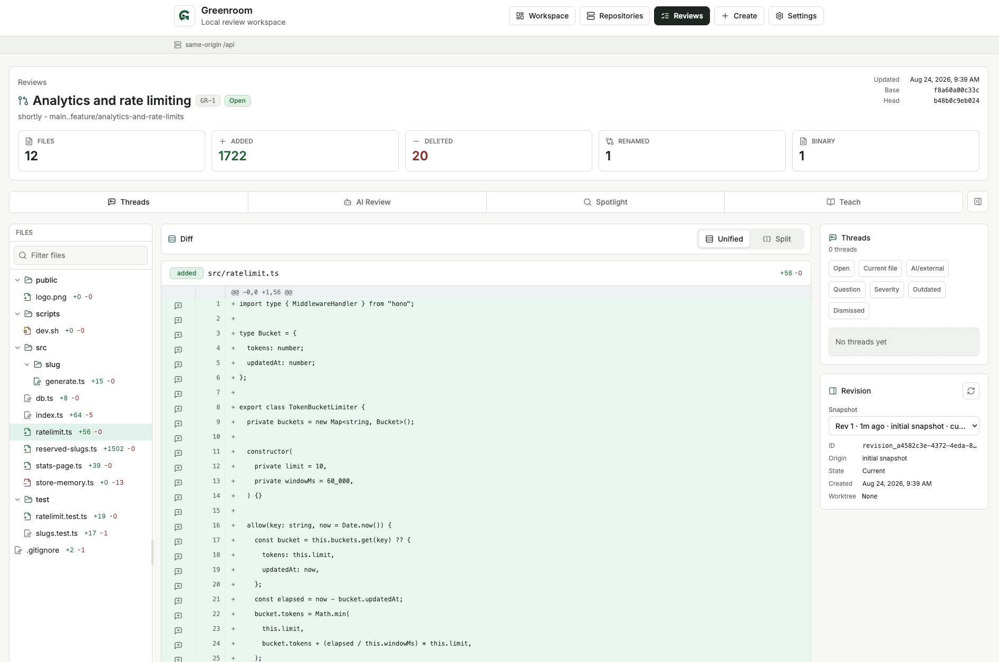

The diff itself should feel familiar — added/deleted/renamed/binary badges
per file, green additions, red deletions — and it renders structured Git
detail like renames with their similarity score:

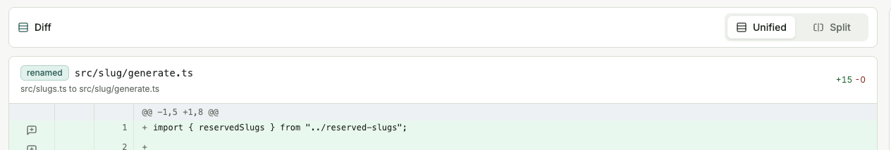

Toggle between **Unified** and **Split** layouts from the toolbar (or with
the `U` and `S` keys):

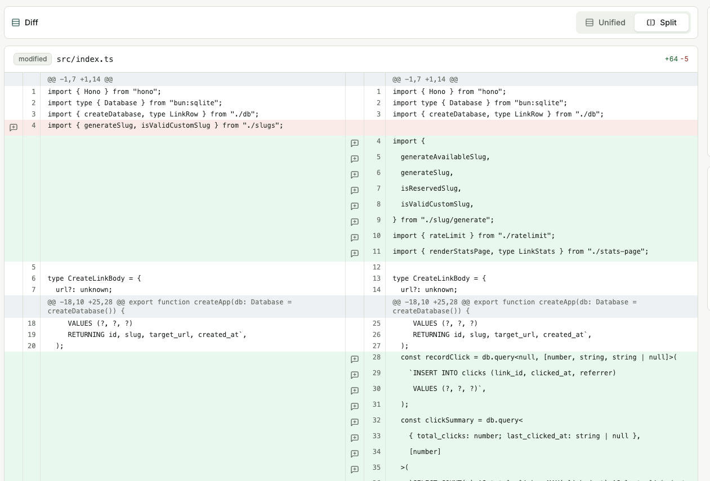

Very large files are truncated to keep the workspace responsive, with
**"Load 600 more"** and **"Load all"** controls when you actually want the
whole thing:

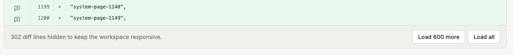

The workspace is keyboard-friendly — `J`/`K` walk files, `[`/`]` walk
threads, `R` refreshes the review. Press `?` for the full reference:

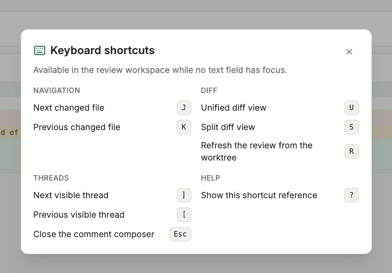

## Threads

Threads are durable comments anchored to changed lines — from you, from
Greenroom's built-in reviewer, or from any agent connected over MCP. Click
the comment button in the gutter of a changed line (or drag across several
lines) to open the composer. Threads have a type — **Question**, **Issue**,
**Suggestion**, or **Note** — and an optional severity from **Blocking**
down to **Nit**. The typing isn't bureaucracy: it's context an agent can
act on, so a question gets an answer while an issue gets a fix.

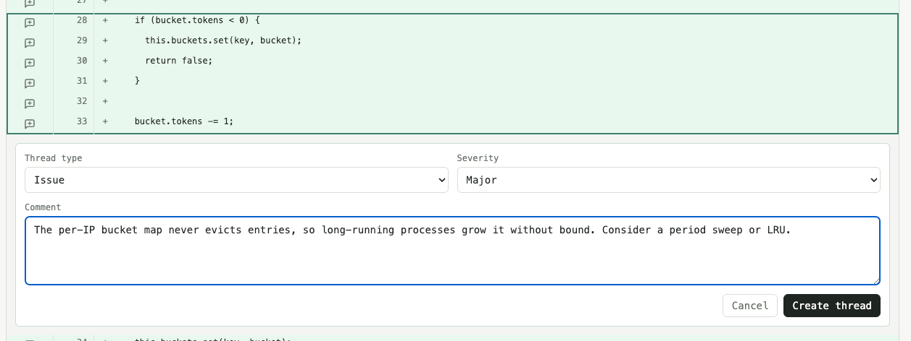

The **Threads** panel on the right lists every thread in the review, with
filters for open threads, the current file, AI/external sources, questions,
severity, and more.

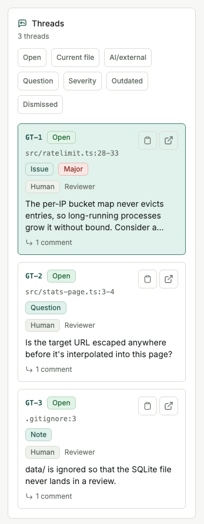

Threads get globally unique ids like `GT-5` (Greenroom Thread) — never
reused, identical in the UI, API, and MCP, so "fix GT-5" is unambiguous to
your agent. Thread states (open, resolved, dismissed) are all reversible.

## Built-in AI review

Time to put your harness to work. Open the **AI Review** tab in the
workspace drawer:

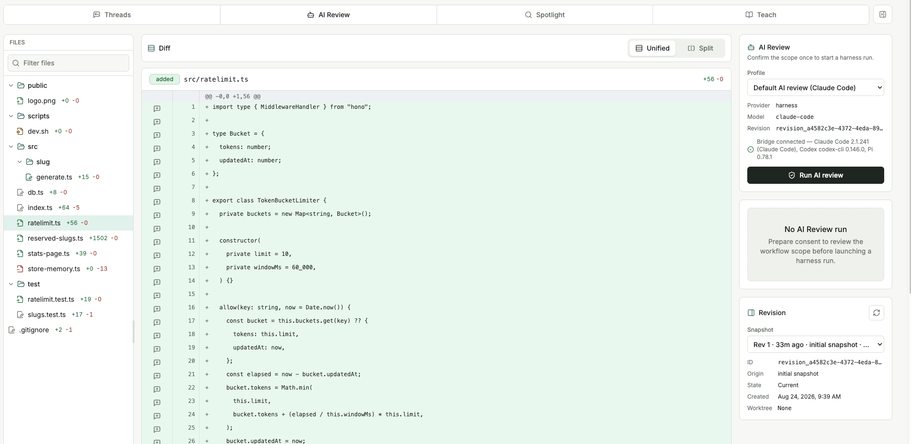

Click **"Run AI review"**. Before anything happens, Greenroom shows you a
consent dialog with exactly what will be shared: the profile, provider,
review, revision, and file scope. Nothing reaches the harness until you
click **"Confirm & run"**.

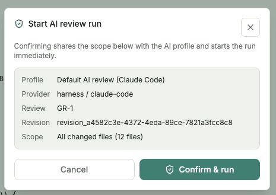

Under the hood, Greenroom launches your harness CLI through its local
bridge, hands it a scoped MCP connection, and asks it to review the change.
The harness reads the diff through Greenroom's MCP tools — the same ones
any external agent can use — and submits findings back as a structured,
schema-validated draft. You can watch progress live, including the
harness's own activity:

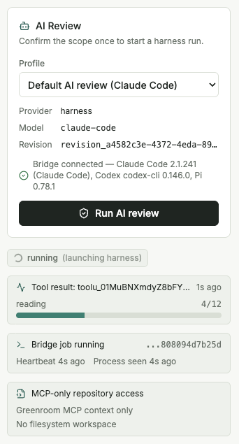

When the run completes, findings arrive as a **draft** — validated, but no
threads exist yet. You review the findings and decide:

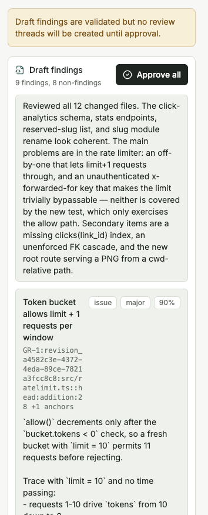

Click **"Approve all"** (or approve selectively) and each finding becomes a
normal review thread, attributed to the built-in reviewer and sitting
inline in the diff next to your own comments:

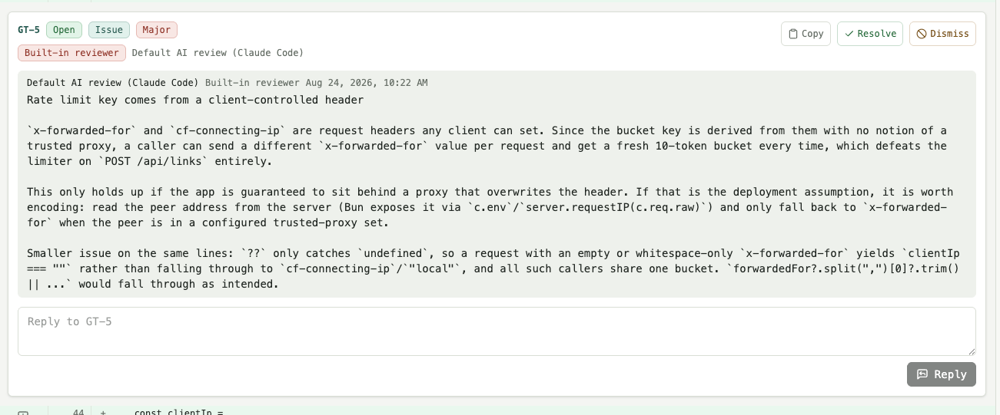

A few things worth knowing: the review prompt is customizable per profile
(Settings → AI Profiles), every run stores a redacted transcript in
Greenroom's local database — inspectable per run, capped by retention
limits, and purgeable from Settings — and profiles can opt into stricter
(two-step) or looser (trusted, auto-created threads) consent modes. Details
in [Harness.md](Harness.md).

## Spotlight

A big review is usually several stories interleaved: a feature, a refactor,
some cleanup. **Spotlight** asks your harness to untangle them. From the
Spotlight tab, click **"Generate"**: after the same consent step, the
harness studies the diff and proposes a *plan* — a set of Views, each with
an intent and description. You can approve the plan as-is, or refine it
with your own instructions ("keep rate limiting and analytics separate")
and get a revised plan before anything is stored.

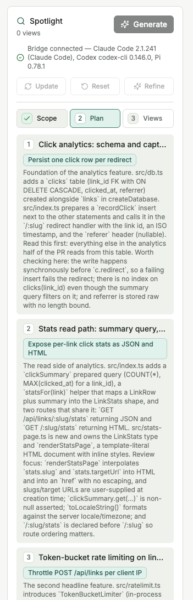

Approving the plan generates the Views:

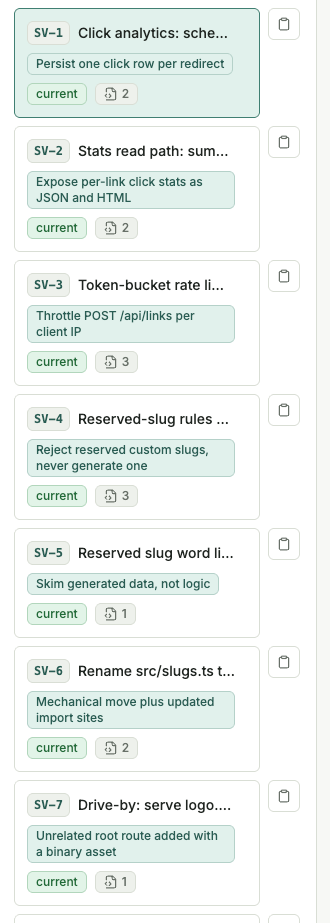

Selecting a View filters the diff to just the lines that belong to that
story — its own sub-diff of the review, with lit lines highlighted and
everything else dimmed. Threads work here exactly as they do in the full
diff.

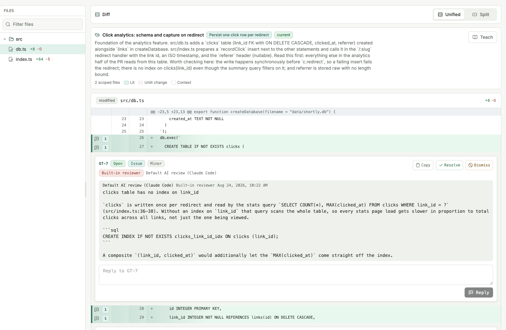

Two details make Views more than a visual filter. The **Coverage** entry
shows every changed line that *no* View explains — so nothing slips through
unreviewed. And Views get ids (`SV-2`) you can hand to an agent to scope
work: "address the open threads in SV-2." Views are read-only over MCP in
this version; agents can inspect them but not edit them.

## Teach

**Teach** is for the change you need to *understand*, not just approve — an
agent's branch, a coworker's work, or a codebase you've just pulled. The
Teach tab opens a dedicated page; pick a scope (the full review, or a
single Spotlight View for something more focused), confirm the consent
summary, and the harness generates an interactive session: a summary, an
architecture explanation, and a walkthrough of the change point by point
with inline diff excerpts and rendered diagrams.

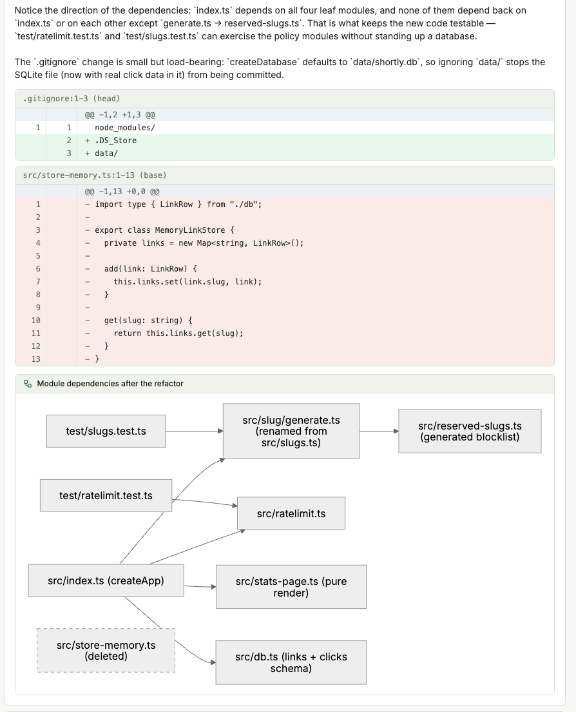

Then it checks whether the explanation stuck: a short quiz with immediate
feedback and a score.

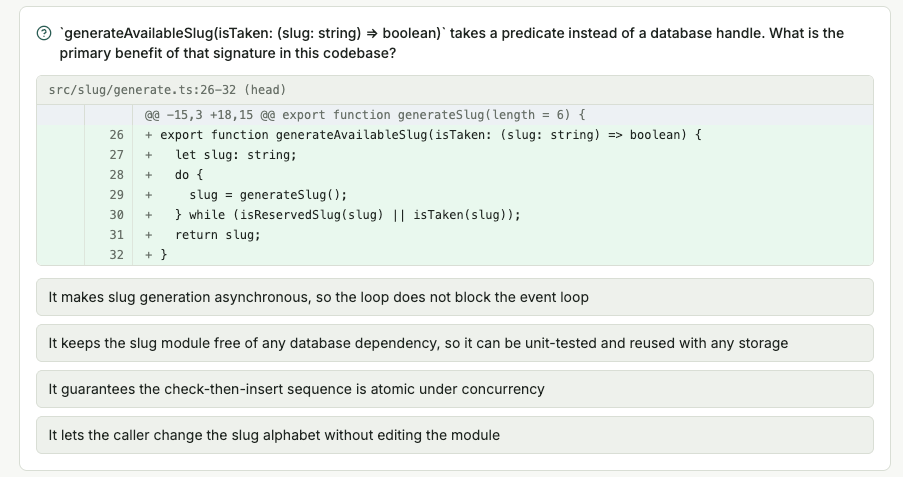

Two touches worth calling out. Any quiz question you miss (or any
walkthrough point) can be **promoted into a real review thread**, so a gap
in your understanding becomes a concrete follow-up in the diff. And the
follow-up Q&A at the bottom lets you keep asking questions — answers stay
within the already-approved scope, and the whole session (minus your quiz
score, which is deliberately ephemeral) survives restarts. More in
[Teaching.md](Teaching.md).

## Closing the loop

Here's the workflow all of this adds up to, using the review you've built:

1. Triage the threads — yours and the AI's. Resolve what's fine, dismiss
   what's noise.
2. Hand the real findings to your coding agent. Thread refs make the prompt
   short: "Fix GT-4 and GT-7 in this repo." (Connected agents can also pull
   a full handoff bundle themselves — anchors, comments, and code snippets —
   through MCP.)
3. Review the fix *before* committing: the **"Review current changes"**
   button on the Workspace page reviews the worktree, uncommitted changes
   included.
4. After committing, go back to the original review and press `R`. Greenroom
   snapshots a new revision, re-anchors every thread onto the new diff, and
   flags any thread it couldn't confidently remap as **Outdated** rather
   than guessing silently. Old revisions stay browsable.
5. Resolve the fixed threads, close the review, push with a clear
   conscience.

The point is that this whole loop happens locally, before a teammate's time
or a CI cycle is spent on the change.

## Bring your own agent

Everything the built-in workflows use is available to any MCP-capable
agent. Settings → Connections has a **"Connect a coding agent"** card that
mints a scoped token and emits ready-to-paste configs — for Claude Code
it's one command:

```sh
claude mcp add --transport http greenroom http://127.0.0.1:49332/mcp \
  --header "Authorization: Bearer <token>"
```

A connected agent can list reviews, read diffs and threads, create
attributed comments, and pull handoff bundles — but only what its token
scopes allow, and never anything that mutates your repository. Threads
created this way show up with an "MCP client" source badge, so you always
know who said what. See [MCP.md](MCP.md) for the tool and resource
reference.

## Good to know

- **Your data**: one SQLite database in the app data dir (the `up` output
  prints the path). `greenroom db backup` takes a consistent snapshot.
- **Your repos**: read-only, always. Greenroom shells out to `git` for
  diffs and never writes index state, commits, branches, or tags.
- **AI transcripts**: redacted before storage, size- and age-capped,
  viewable per run, and purgeable from Settings → General.
- **Configuration**: a `greenroom.toml` in the app data dir, editable from
  Settings, with env vars reserved for secrets and overrides
  ([Environment.md](Environment.md)).

## Where to next

- [CLI.md](CLI.md) — every `greenroom` command and how `up` supervises the stack.
- [Harness.md](Harness.md) — harness detection, profiles, consent modes, timeouts, the Pi fallback.
- [Threads.md](Threads.md) — the full thread model: states, types, severity, anchors.
- [Teaching.md](Teaching.md) — the Teach page in depth.
- [MCP.md](MCP.md) — connecting external agents, token scopes, tools and resources.
- [Docker.md](Docker.md) — running the stack in a container.
- [Git.md](Git.md) — exactly what Greenroom does and doesn't do with Git.
